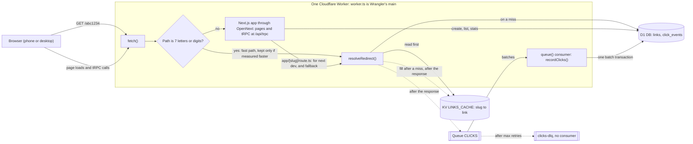
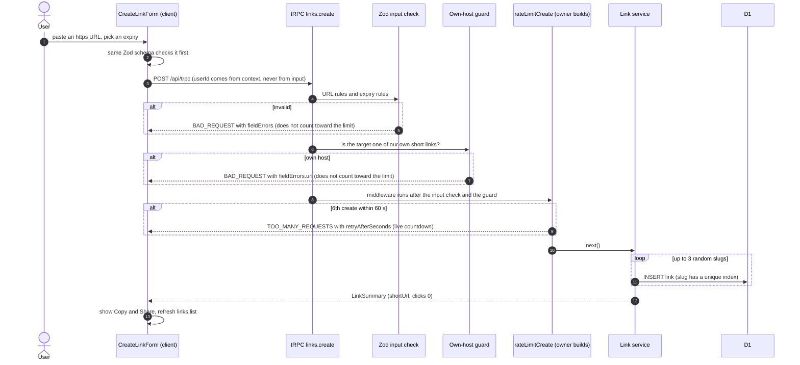
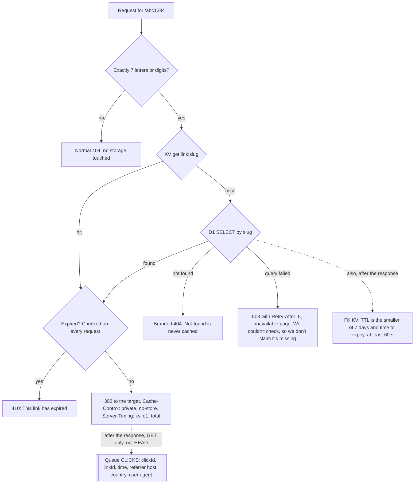
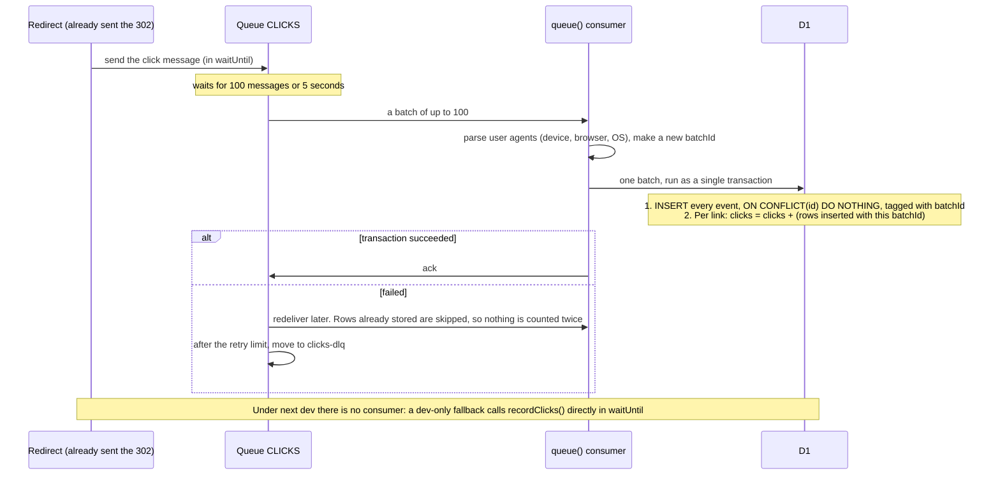
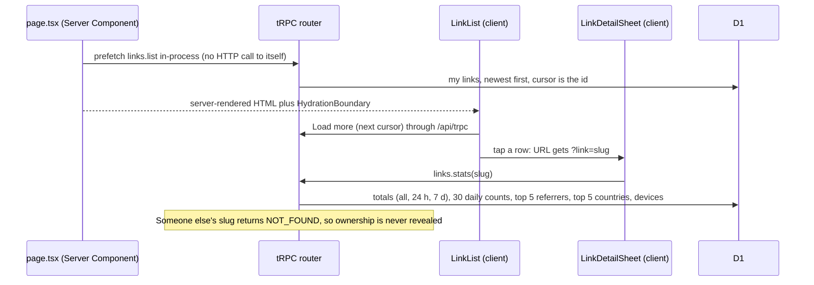
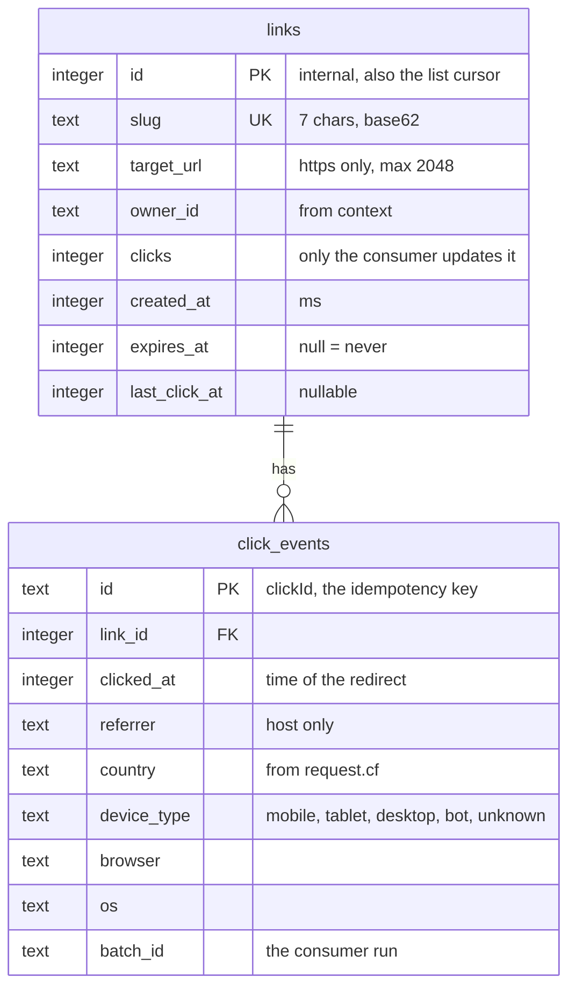

# How the app flows

These diagrams were drawn from the approved spec and checked against the foundation plan. **The spec wins:** if a
diagram disagrees with it, fix the diagram. GitHub renders the mermaid blocks.

## 1. Overview

## 2. Create a link

## 3. Redirect

## 4. Click pipeline

## 5. List and link details

## 6. Data model

Indexes: `links(owner_id, id)`; `click_events(link_id, clicked_at)` and `click_events(batch_id, link_id)`. No IP
addresses are stored.
